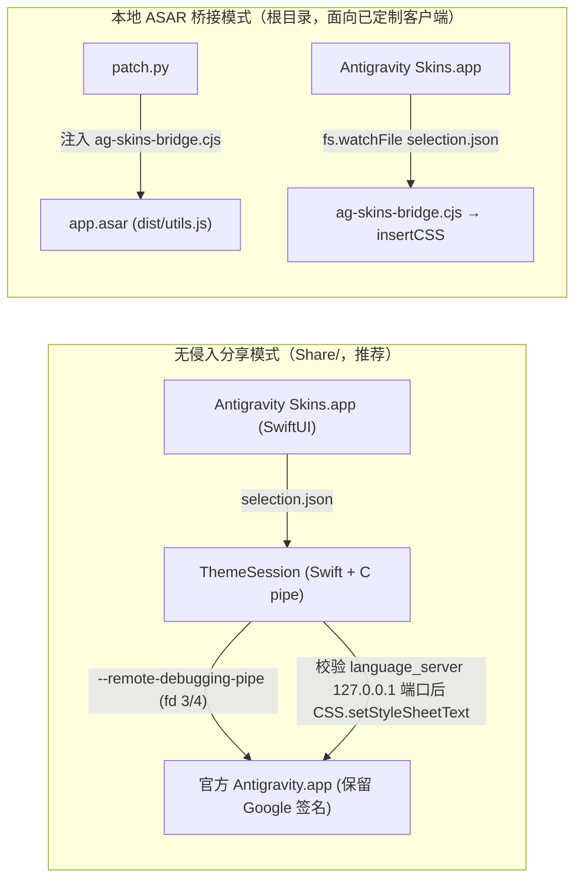

# Antigravity Skins

原生的 macOS SwiftUI 皮肤管理器，为 **Antigravity 桌面版（Apple Silicon）** 提供可视化壁纸皮肤库、强调色定制与免重启实时热更新。

## 核心特性

- **无侵入签名保留（Share 版，推荐）**：通过私有 `--remote-debugging-pipe` 管道启动官方客户端并动态注入样式表，**完全不修改 `Antigravity.app` 本体与 Google 代码签名**。想恢复原版时，直接从菜单选「使用原版外观」或下次直接打开官方客户端即可。
- **原生 SwiftUI 皮肤库**：
  - 支持「全部 / 最近用过 / 已删除」分栏、实时搜索与分页卡片预览（每页 6 款）；
  - 支持导入自定义壁纸（JPG / PNG / HEIC / WebP）与强调色，内置软删除与一键恢复；
  - 点击卡片即刻生效，**免重启热更新**，关闭皮肤管理器后当前窗口仍保持已选皮肤。
- **壁纸可读性专项优化**：
  - 自动适配深色 / 浅色主题，暖暗中性阅读底色避免冷暖壁纸串色；
  - 用户气泡操作栏、AI 反馈栏、后台任务状态条与主页引导语采用紧凑毛玻璃胶囊（`backdrop-filter: blur` 柔化高频壁纸纹理，不遮挡壁纸主体）；
  - 主页问候语去胶囊化裸字排版 + 无边缘柔和径向暗晕；
  - 侧边会话轮次导航配备 20px 细长磨砂轨道与主题色激活外环；
  - 约束会话阅读宽度与宽表格溢出，防止长表格撑破卡片。

## 工作原理

项目包含两种运行模式：



### 安全与作用域边界（Share 版）

- **签名校验**：启动前通过 `SecStaticCodeCheckValidity` 验证目标为 Google 签名的 `com.google.antigravity`（`OU=EQHXZ8M8AV`），并检查关键可执行组件完整（不硬锁单一小版本号，客户端常规升级后可继续使用）。
- **页面白名单**：仅查询当前 Antigravity 子进程 `language_server` 实际监听的 `https://127.0.0.1:<port>` 本地端口并注入 CSS；登录页等外部页面沿用官方默认外观，不会被注入。
- **状态隔离**：皮肤库配置、选中记录与自定义壁纸保存在 `~/Library/Application Support/Antigravity Skins Share/`，不污染官方客户端目录。

## 快速使用（预编译 Release）

适用于 **Apple 芯片、macOS 14+** 以及 Google 签名的官方 **Antigravity** 桌面版（已在 `2.33.0` 验证）：

1. 前往 [Releases](../../releases) 下载最新 `Antigravity-Skins-1.2-Mac-arm64.zip` 并解压，将 `Antigravity Skins.app` 拖入「应用程序」（保留已安装的官方 `Antigravity.app`）。
2. 首次打开若提示「已损坏」或「无法验证开发者」（因安装包为本地 ad-hoc 签名、未经过 Apple 公证），在终端执行一次以下命令解除下载隔离属性即可：
   ```bash
   xattr -dr com.apple.quarantine "/Applications/Antigravity Skins.app"
   ```
3. 保存工作并完全退出当前运行的 Antigravity。
4. 打开 `Antigravity Skins`，选中一款皮肤后点击 **「带皮肤启动」**（若官方客户端安装在自定义目录，点右上角 `…` →「选择 Antigravity…」）。
5. 切换皮肤直接点击其他卡片即可实时生效；点卡片右下角铅笔可修改名称、壁纸与强调色；点右上角 `…` →「使用原版外观」可随时恢复默认样式。

## 从源码本地构建

前置条件：Apple Silicon Mac、macOS 14+、已安装 Apple Command Line Tools（`xcode-select --install`）。

### 1. 构建无侵入分享版（`Share/build.py`，推荐）

先准备一个壁纸素材目录 `<catalog-dir>`，结构如下：

```text
<catalog-dir>/
├── catalog.json          # [{"id":"my-theme","name":"示例主题","image":"background.jpg","accent":"#e87147"}]
└── my-theme/
    ├── background.jpg    # 支持 .jpg / .png / .webp
    └── preview.jpg       # 卡片缩略图
```

执行构建：

```bash
mkdir -p build
/usr/bin/python3 Share/build.py build "<catalog-dir>"
```

构建脚本会编译 `ThemeSession`（C pipe + Swift）与 `AntigravitySkins`（SwiftUI），完成本地签名并通过 `codesign --verify --deep --strict` 校验，产物输出在 `build/Antigravity Skins.app`。

### 2. 构建本地桥接版（面向已定制/汉化客户端）

```bash
# 从本地 CodexDreamSkinStudio 主题库构建皮肤管理器
mkdir -p build
/usr/bin/python3 build.py build

# 将热更新桥接写入已 staging 的 Antigravity.app
/usr/bin/python3 patch.py /path/to/Antigravity.app
```

## 目录结构

```text
.
├── Gallery.swift          # SwiftUI 主界面（分栏、搜索、分页卡片、热更新状态）
├── Catalog.swift          # 皮肤库存储、文件锁、缩略图生成与自定义壁纸导入
├── SkinEditor.swift       # 新增 / 编辑皮肤弹窗（壁纸选择器 + 强调色）
├── Gallery.icns           # 应用图标
├── bridge.cjs             # 本地 ASAR 模式的热更新桥接脚本
├── patch.py               # 本地 ASAR 补丁脚本
├── build.py               # 本地版打包脚本
└── Share/                 # 无侵入签名保留版（推荐）
    ├── Launcher.swift     # 宿主状态检测与 ThemeSession 进程拉起
    ├── Session.swift      # CDP 私有管道会话管理与动态 CSS 注入
    ├── Shared.swift       # 官方客户端签名校验与共享路径定义
    ├── pipe.c / pipe.h    # posix_spawn + fd 3/4 私有调试管道与子进程校验
    ├── skin-template.css  # 壁纸皮肤主样式模板（含浮层毛玻璃与可读性优化）
    ├── build.py           # 独立打包与严格代码签名校验脚本
    └── 使用说明.txt        # 同事分发使用指南
```

## 致谢与说明

- 本仓库仅包含皮肤管理器源码与样式模板，不包含第三方版权壁纸原图。
- Release 预置壁纸来自原有 Codex Dream Skin 主题库；其中 Crayon Shin-chan 主题包标注作者 `clownR`、许可 `MIT`。
